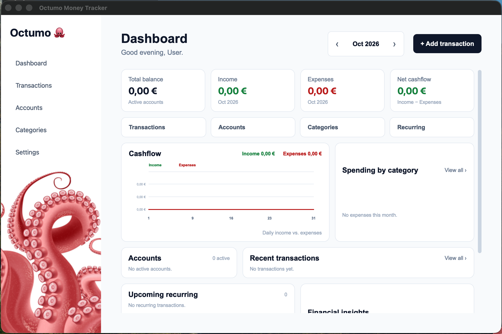

# 🐙 Octumo Money Tracker

A desktop application for personal finance management, built with Python and PySide6.

Octumo helps you keep track of your finances through a clean, modern interface. Manage transactions, accounts, categories and recurring payments while monitoring your financial activity from a single dashboard.

## ✨ Features

- **Dashboard** — Overview of your financial situation, including total balance, income, expenses and net cash flow.
- **Transaction management** — Add and manage income and expenses.
- **Accounts** — Manage your financial accounts and balances.
- **Categories** — Organize transactions into categories.
- **Recurring transactions** — Set up and manage recurring income and expenses.
- **Cash flow visualization** — View income and expenses over time.
- **Spending overview** — Explore expenses by category.
- **Settings** — Customize application settings.
- **Local database** — Store financial data locally using SQLite.

## 🖥️ Screenshots

### Dashboard



> Screenshots will be added to this repository.

## 🛠️ Built With

- **Python** — Application logic
- **PySide6** — Desktop graphical user interface
- **SQLite** — Local database
- **Matplotlib** — Charts and data visualization
- **OpenPyXL** — Excel file support

## 📋 Requirements

Before installing Octumo, make sure you have:

- Python 3.10 or newer
- Git
- pip, which is included with standard Python installations

Check your Python installation:

```bash
python3 --version
```

Check Git:

```bash
git --version
```

## 🚀 Installation

Follow these steps to run Octumo Money Tracker locally.

### 1. Clone the repository

```bash
git clone https://github.com/Sam27uel/Octumo-money-tracker.git
```

Navigate to the project directory:

```bash
cd Octumo-money-tracker
```

### 2. Create a virtual environment

A virtual environment keeps the project's dependencies separate from your other Python projects.

**macOS / Linux:**

```bash
python3 -m venv .venv
```

**Windows:**

```powershell
py -m venv .venv
```

### 3. Activate the virtual environment

**macOS / Linux:**

```bash
source .venv/bin/activate
```

**Windows — PowerShell:**

```powershell
.venv\Scripts\Activate.ps1
```

**Windows — Command Prompt:**

```cmd
.venv\Scripts\activate.bat
```

Once activated, your terminal should indicate that the virtual environment is active.

### 4. Install dependencies

Upgrade pip:

```bash
python -m pip install --upgrade pip
```

Install the required packages:

```bash
pip install -r requirements.txt
```

The dependencies are defined in `requirements.txt`:

- PySide6
- Matplotlib
- OpenPyXL

### 5. Run the application

From the project's root directory, run:

```bash
python main.py
```

The Octumo Money Tracker desktop application should open.

## 📁 Project Structure

```text
Octumo-money-tracker/
├── app/
│   ├── charts/          # Chart-related components
│   ├── database/        # Database initialization and access
│   ├── services/        # Application logic and data operations
│   └── ui/              # User interface and dialogs
├── data/                # Local application data
├── tests/               # Tests
├── main.py              # Application entry point
├── requirements.txt     # Python dependencies
├── README.md
└── .gitignore
```

## 💾 Data Storage

Octumo uses a local SQLite database to store application data.

The `data/` directory is used for local application data. Database files are excluded from Git to prevent personal financial information from being accidentally published.

**Important:** Back up your database regularly if you use the application to track real financial information. Do not commit a database containing personal or financial data to a public repository.

## 🧑‍💻 Development

To start developing, activate the virtual environment and install the dependencies as described in the installation instructions.

Run the application with:

```bash
python main.py
```

Before committing changes, check that the application starts correctly and that your changes do not break existing functionality.

## 🗺️ Roadmap

Potential areas for future development include:

- Additional financial analytics
- More customization options
- Improved reporting and data visualization
- Further usability improvements

## 📄 License

No license has been specified yet.

Unless a license is added to this repository, the project should not be assumed to be available for unrestricted reuse, modification or redistribution.

## 👤 Author

**Samuel**

GitHub: [@Sam27uel](https://github.com/Sam27uel)

---

Made with Python and a little octopus inspiration. 🐙
